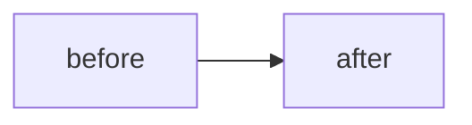

# <number> <Short title>
date: YYYY-MM-DD

## End state
<!-- Diagrams first: what exists when this is done, drawn. Then the expected result as a short checklist. What and why, never how. -->

- [ ] <something that is true when this is done>

## Arrival decisions
<!-- One per answer that shaped the work. Not the Q&A. -->

### D1. <one line: the decision>
Why: <the reason>
Not taken: <an option>, why it lost. <another option>, why it lost.

## Settles
<!-- The ADRs and standards this leads to, as a list, or "none". -->
