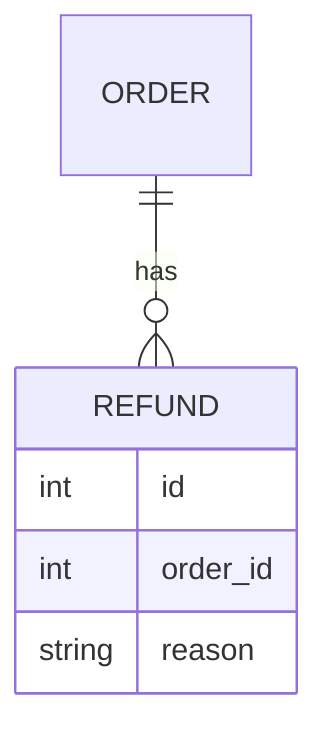
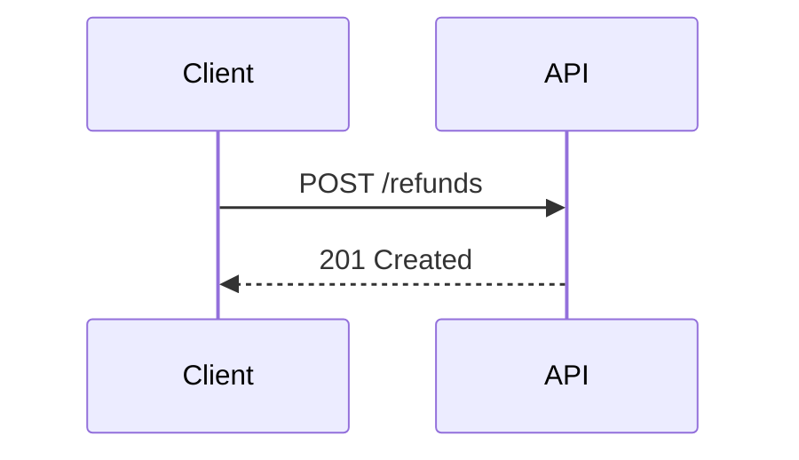
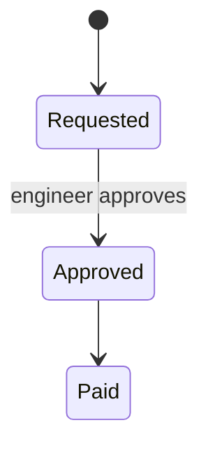
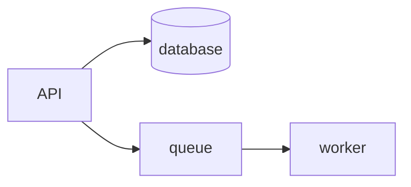
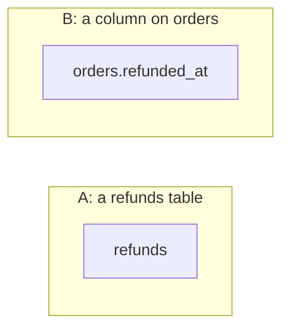

# Which diagram for which question

Every question gets a diagram. Pick the kind that shows the decision, not the one that is easiest to draw.

| The question is about | Diagram |
|---|---|
| A schema or data change | ER diagram, before and after |
| A flow between parts | Sequence diagram, or a flowchart when there is no timeline |
| A status or lifecycle | State diagram |
| Which parts exist and how they depend | Component flowchart |
| Choosing between options | The options side by side, one box each |

Rules: one idea per diagram, about twelve nodes at most, every edge labelled when the label says something, Mermaid only so it renders on GitHub. Add one italic line under it that names the thing to notice.

## A schema change

## A flow

## A lifecycle

## Parts and dependencies

## Options side by side

