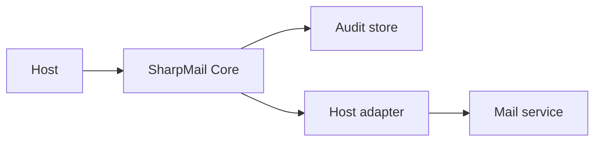

# SharpMail
covers: building the libraries, running the local demo and finding the audit documentation

## What this is

SharpMail records a finalized email before handing it to an application's sender. A support engineer can retrieve the message, its SDK outcome and recipient history by attempt ID.

## Prerequisites

Install the .NET 11.0.100 SDK or a compatible 11.0.1xx patch. The local demo also uses Aspire CLI 17 and a running Podman machine. The SDK reported 11.0.100 on f5ae361. [SDK downloads](https://dotnet.microsoft.com/download/dotnet/11.0) · [Aspire setup](https://aspire.dev/get-started/install-cli/) · [Podman installation](https://podman.io/docs/installation)

## Get it running

1. Clone with `git clone git@github.com:chandanbsd/sharp-mail-service.git` (not run), then enter the checkout with `cd sharp-mail-service` (not run).
2. Build with `dotnet build` (not run with restore). Using existing restored dependencies, `dotnet build --no-restore -m:1` ran on f5ae361 and built all eight projects with zero warnings and errors.
3. Launch from the root with `ASPIRE_CONTAINER_RUNTIME=podman aspire run` (not run). Wait for the store and API to become ready in the dashboard.
4. Open `http://localhost:18081/scalar`. Use POST /attempt-ids and copy the ID into the PUT /attempts/{id} receipt example. Read the same ID with GET /attempts/{id}.
5. With the demo running, `dotnet run demo/Walkthrough.cs -- sql` exercises the local SQL API (not run). It checks preview, repeats, conflicts, callbacks, SDK rejection and concurrent submissions.

## Repo map

| Folder | Start here |
|---|---|
| src/ | [Architecture](architecture/README.md) shows how the six library packages interact. |
| demo/ | [Deployment](deploy/README.md) explains the Aspire host and the three APIs. |
| baseline/docs/ | Follow the [course](course/README.md) or browse [features](features/README.md), the [glossary](reference/glossary.md) and the [file map](reference/file-map.md). |
| docs/ | The original [design review](../../docs/design.md) describes the lifecycle. |

## Configuration

| Name | Purpose | Source or default | Secret |
|---|---|---|---|
| AuditProvider | Selects the audit store | Set per API by Aspire | No |
| MailpitEndpoint | Identifies the demo sender's SMTP endpoint | Supplied by Aspire | No |
| StoreEndpoint | Addresses the Blob or Cosmos emulator | Supplied for the selected provider | No |
| StorageKey | Authenticates to Azurite | Supplied for Blob | Yes |
| ConnectionStrings__SharpMail | Connects to the SQL database | Supplied for SQL | Yes |

## Troubleshooting

| Symptom | Check | Action |
|---|---|---|
| SDK selection fails | Compare the installed patch with global.json | Select a compatible 11.0.1xx SDK. |
| Receipt lookup returns 404 | Compare the API port with the one used to submit | Use the original backend and attempt ID. |
| Startup pauses | Read the selected storage resource's dashboard logs | Wait for initialization before opening Scalar. |
