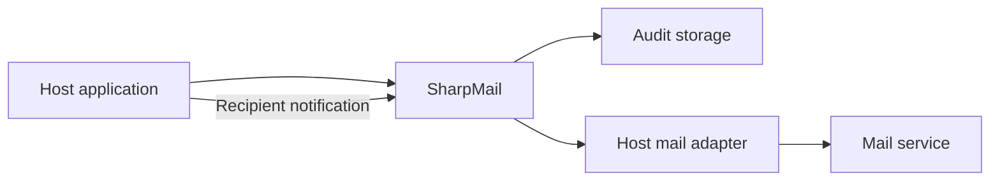
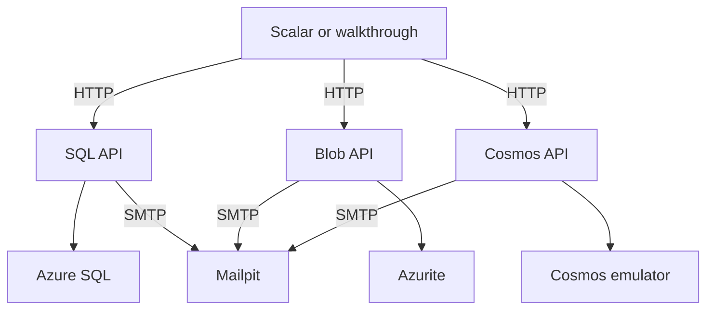
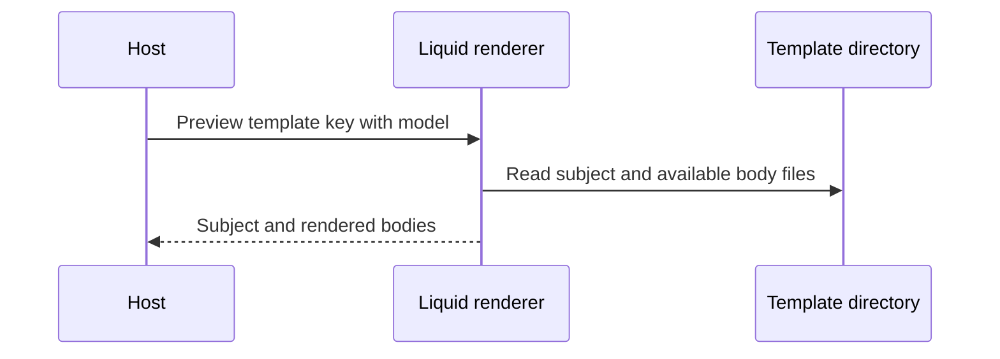
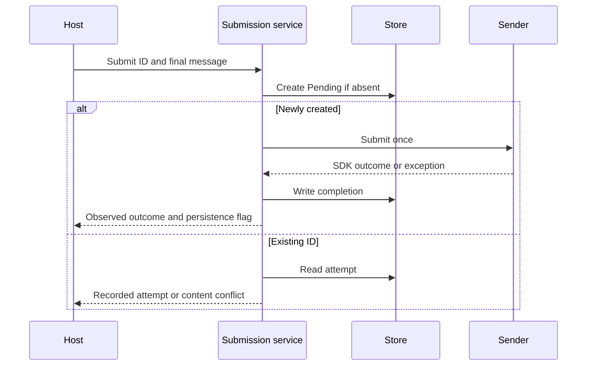
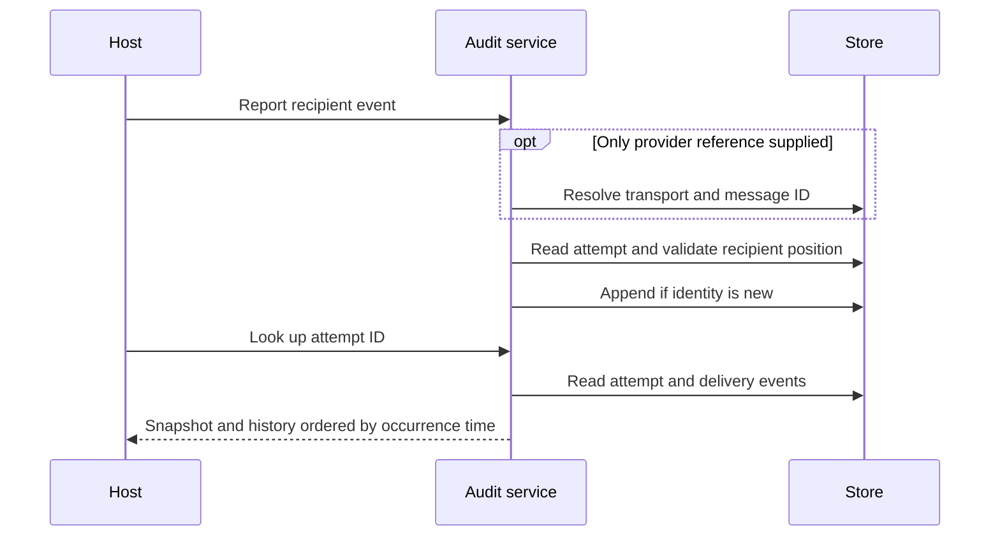
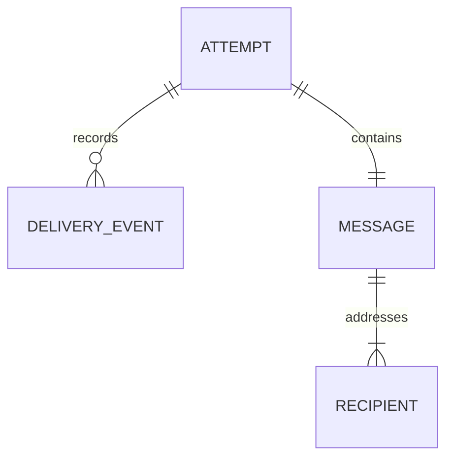

# Architecture
covers: how a host records a message, submits it once and retrieves recipient history

## What the system is

SharpMail is a .NET library for auditing the exact message passed to a host's mail adapter. Its ASP.NET Core demo connects three instances to different audit stores. The repository contains an ADR template and no recorded architecture decisions.

## Big picture

## Components

| Package | Responsibility and dependencies |
|---|---|
| Data | Owns message, attempt and event records, JSON representation, event identity and the storage interface. |
| Core | Depends on Data. Validates submissions, invokes the sender and resolves delivery notifications. |
| Renderer.Liquid | Implements the Core renderer contract using Fluid and files under a host-supplied root. |
| Context.AzureSqlServer | Implements Data's storage interface with EF Core, a JSON payload per row and separately keyed delivery rows. |
| Context.AzureBlobStorage | Uses Data's contracts to create separate snapshot, completion, provider lookup and event blobs. |
| Context.AzureCosmosDb | Stores Data's attempt and event payloads in items partitioned by attempt ID. |

## Key flows

## Data

Submission writes the versioned snapshot and SDK outcome. Audit writes each event with a recorded time and a recipient role and index into the snapshot.

## Failure model

A failed initial write prevents sender invocation. If completion fails after invocation, the result carries the observed status and `OutcomePersisted=false`. A lookup can still show Pending. An exact repeat reads the stored state, even while the original call is running. SDK acceptance and delivery to a recipient are recorded independently.

## Interfaces and contracts

A host supplies an `IEmailSender` and calls `AddSharpMail<TSender>()` to register the scoped sender, submission and audit services. The sender receives the attempt ID and finalized message and returns an `EmailSendResult`. It supplies the transport name used for provider-ID lookup. `TimeProvider.System` supplies audit timestamps.

| Store registration | Host provides |
|---|---|
| `AddSqlEmailAudit` | SQL connection string and migrated schema. The registration disables ambient transaction enlistment. |
| `AddBlobEmailAudit` | An existing BlobContainerClient for the audit container. |
| `AddCosmosEmailAudit` | A Cosmos Container partitioned by /attemptId. |

A host can pass final content directly or register the optional renderer with `AddLiquidEmailTemplates(rootDirectory)`.
