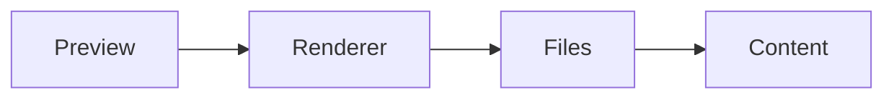

# Preview a receipt
covers: rendering a template into final message content

## The flow



[System architecture and key flows](../architecture/README.md#key-flows)

## Walkthrough

The API passes a template key and string model to the renderer. Fluid resolves variables as it reads each file. HTML rendering uses an encoder. Text and subject retain their plain values.

`src/SharpMail.Renderer.Liquid/Services/LiquidEmailRenderer.cs`

```csharp
await RenderFileAsync("body.html.liquid", HtmlEncoder.Default)
```

## Alternatives and why this one

The submission API also accepts already-rendered content. Separate preview lets an application inspect the same subject and bodies it later submits.

## Pitfalls and failure modes

Missing variables, invalid keys and multiline subjects fail validation. Either body file can supply the required body.

## Practice

1. Trace the name Pat & Jo through both bodies. Expect an encoded ampersand in HTML and a literal ampersand in text.
2. Remove both body files from a hypothetical template. Expect a validation error.
