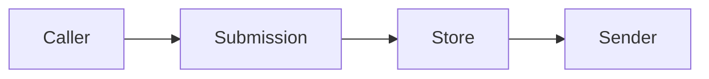

# Submit and identify an attempt
covers: allocating a reference and submitting a finalized message

## The flow



[System architecture and key flows](../architecture/README.md#key-flows)

## Walkthrough

The service allocates a version 7 GUID on request. Submission validates addresses and content before trying to create the snapshot. Only the successful creator calls the adapter. A competing caller reads the stored message and compares its serialized values.

`src/SharpMail.Core/Services/EmailSubmissionService.cs`

```csharp
return new(existing.ToResult(), Reused: true, OutcomePersisted: true);
```

## Alternatives and why this one

A fresh attempt ID permits another intentional send. Reusing the ID preserves one submission per reference, which the concurrent case in demo/Walkthrough.cs checks.

## Pitfalls and failure modes

Changed content conflicts. An adapter exception produces Failed. An unsuccessful completion write leaves the caller with the observed outcome and a false persistence flag.

## Practice

1. Change only the correlation ID on a repeat. Expect the original correlation ID.
2. Trace a retry while the adapter is still running. Expect the existing Pending snapshot.
