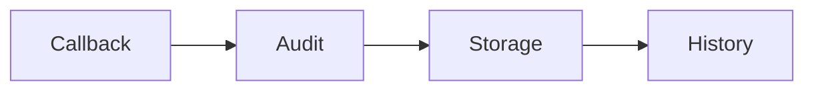

# Reconstruct recipient history
covers: resolving callback references and reading an attempt with ordered events

## The flow



[System architecture and key flows](../architecture/README.md#key-flows)

## Walkthrough

A callback supplies the attempt ID, or the service queries by transport and provider message ID. The recorder checks the original recipient list and hashes role, index and event ID for deduplication. Lookup reads both the attempt and events.

`src/SharpMail.Core/Services/EmailAuditService.cs`

```csharp
if (matches.Count != 1) return null;
```

## Alternatives and why this one

The direct attempt reference can resolve before a provider ID has been recorded. The provider reference also works when a host has only the transport identifiers.

## Pitfalls and failure modes

Unknown or ambiguous references return an unresolved result. Invalid roles and out-of-range indexes fail validation. A duplicate returns false.

## Practice

1. Report the same event ID for To index 0 and Cc index 0. Expect two distinct identities.
2. Read two events received in reverse occurrence order. Expect the earlier occurrence first.
