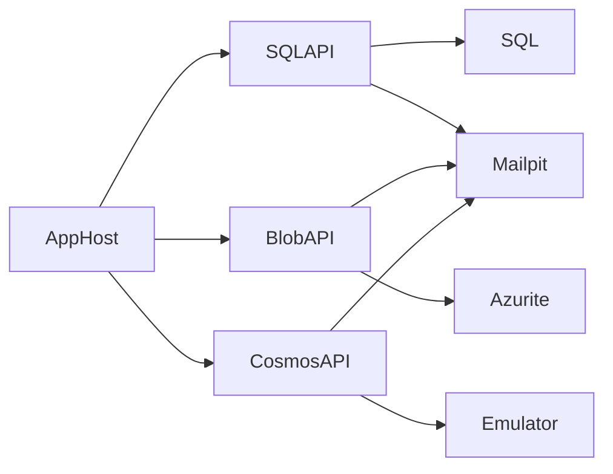
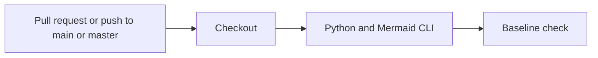

# Run the local demo
covers: building and operating the Aspire demo with three independent audit stores

## Topology

## Environments

The local AppHost builds three copies of the API. Each exposes Scalar at `/scalar` on localhost. SQL uses port 18081, Blob 18082 and Cosmos 18083. Mailpit's inbox uses 18025. GitHub Actions runs the baseline check on Ubuntu.

## Configuration and secrets

| Name | Purpose | Source and default | Secret |
|---|---|---|---|
| AuditProvider | Selects sql, blobs or cosmos | AppHost per API, required | No |
| MailpitEndpoint | Local SMTP endpoint | AppHost service discovery, required | No |
| ConnectionStrings__SharpMail | SQL connection | Aspire database reference for SQL | Yes |
| StoreEndpoint | Blob or Cosmos URL | AppHost endpoint for that store | No |
| StorageKey | Azurite account key | AppHost for Blob | Yes |
| AZURITE_ACCOUNTS | Defines emulator account | AppHost for Azurite | Contains key |
| MP_SMTP_ALLOWED_RECIPIENTS | Limits capture to demo.invalid recipients | AppHost for Mailpit | No |
| MP_SMTP_DISABLE_RDNS | Disables reverse DNS | AppHost sets true | No |
| ASPIRE_CONTAINER_RUNTIME | Selects local container runtime | Set to podman for the documented launch | No |

## Pipeline

The checked-in workflow validates baseline documentation. Locally, the API Dockerfile publishes a Debug build and copies its output into the .NET 11 ASP.NET runtime image.

## Deploying and rolling back

1. Start a Podman machine with the .NET 11.0.1xx SDK and Aspire CLI 17 available. `dotnet --version` ran on f5ae361 and returned 11.0.100.
2. From the repository root run `ASPIRE_CONTAINER_RUNTIME=podman aspire run` (not run). The API initializes its own audit store before serving requests.
3. Open the store's Scalar page and Mailpit. To stop an interactive launch, interrupt Aspire. The named audit volumes retain data. Running an older checkout rebuilds the API from that revision. The repository supplies no automated data rollback.

## Troubleshooting

| Symptom | Check | Action |
|---|---|---|
| API still starting | Dashboard logs show storage initialization retries | Wait for its database or emulator to become ready. Startup uses a three-minute cancellation window. |
| Attempt missing | Compare the API port with the original submission | Read from the same backend. |
| Message marked Failed | Inspect the stored failure code and SMTP recipient domain | Use the walkthrough's local demo addresses. |
