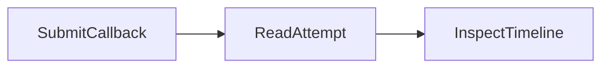

# Recipient history
covers: read the original snapshot and subsequent evidence for individual recipients

## What it is and why

Read the original snapshot and subsequent evidence for individual recipients.

## Who can use it

Anyone with access to the demo API can use this operation.

## What a person can do

POST /delivery-events reports whether a notification was appended. GET /attempts/{id} shows the stored sender, recipients, content, submission outcome and events ordered by occurrence time.

## When things go wrong

An unknown attempt returns 404 on lookup. A callback with an unresolved identifier returns 422. An invalid role or recipient index returns 400.
