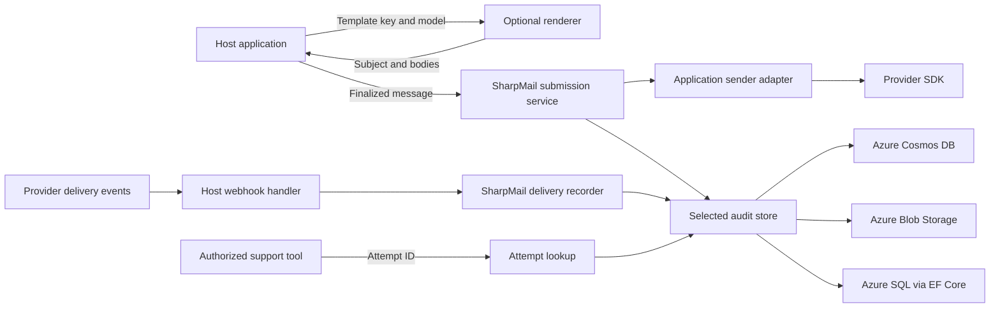
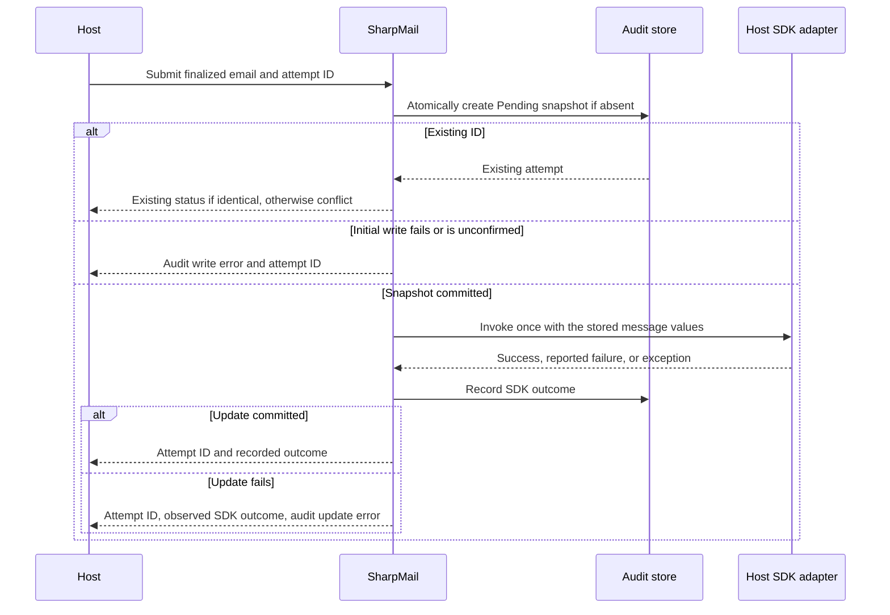
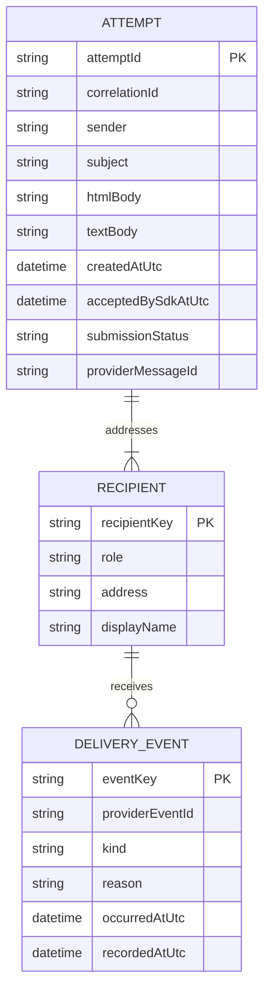

# SharpMail v1 design review

**Status** — Proposed design for review. Implementation requires separate, explicit approval.

## Purpose and scope

A support engineer opens an attempt reference from a ticket and retrieves the exact message prepared for the application’s mailer, the recorded SDK call outcome, and any subsequent recipient delivery evidence. A later template revision or intentional resend leaves the original attempt intact.

SharpMail runs inside the host process. The application chooses when to submit, supplies credentials and an SDK adapter, and owns the support interface. The audit store commits independently of the application's business transaction. A crash between a business commit and submission can leave a business record without a corresponding attempt. This gap is accepted for v1. Automatic retries, a transactional outbox, redaction, and automated deletion are outside v1.

## Component diagram

Each deployment chooses one audit backend. SharpMail.Data owns the audit schema and IEmailAuditDataContext persistence contract. SharpMail.Core owns submission, lookup, delivery recording, and the sender and renderer contracts. Each sink depends on Data. The optional Liquid package implements the Core renderer contract. DI registration binds the selected store and the host's adapter. For SQL the goal is a connection configuration and one registration call. The package supplies mappings and schema migrations, and the host controls migration deployment.

## Message preparation

The input to submission contains finalized addressing, subject, and at least one body. HTML and plain text may coexist. The adapter maps those values into its SDK and may attach the attempt ID as provider metadata. The snapshot represents this handoff. Provider-side transformations and actual inbox appearance are outside its scope.

Rendering is independently usable for preview. Applications may supply pre-rendered content, use FluentEmail, or adopt the proposed Liquid renderer. A proposed convention places subject.liquid, body.html.liquid, and body.txt.liquid under a folder for each template key. At least one body file is required. Preview and submission preparation use the same rendering rules. Template provenance is optional so externally rendered content can use the same submission path.

## Submission sequence

The library generates a unique attempt ID that the host can obtain before calling submit. The optional application correlation ID may repeat across attempts. Once a snapshot exists, a second submit with the same attempt ID never invokes the adapter. Equal message values return the existing status, including Pending. Different sender, recipients, subject, or bodies produce a conflict. An intentional resend uses a fresh attempt ID. Concurrent writers must use an atomic create operation. A lookup followed by an unconditional write cannot enforce this guarantee.

Pending means the initial snapshot exists and the final result has yet to be recorded. A crash immediately before the SDK call and a crash immediately after it can leave identical Pending records. SDK success sets Accepted and records AcceptedBySdkAtUtc. A failure response or thrown exception sets Failed and leaves that timestamp empty. A timeout counts as a failed call even if the remote provider acted on it. Later delivery events preserve the observed SDK outcome. The one-call guarantee applies to SharpMail's invocation of the host adapter. The host controls any internal SDK retry settings.

## Logical audit model

Store a schema version, sender display name and reply-to when supplied, and preserve the To, Cc, and Bcc lists. Capture full subject and all supplied bodies for every stored message, including failed submissions. The original snapshot is immutable. Outcome updates can include completion time, transport identity, provider message ID, and a sanitized failure diagnostic. The proposed status string is authoritative. A convenience success flag, if exposed, is derived and has no value while Pending.

Delivery history belongs to individual recipients. A recipient may have several events, such as deferral followed by bounce. Delivered means the destination mail server reported acceptance through the provider. Provider event time and local ingestion time are distinct, so delayed callbacks remain interpretable. The host authenticates callbacks and maps provider-specific values. Prefer an echoed attempt ID, otherwise match a provider message ID scoped to the provider account. Use recipient evidence to resolve the destination. Ambiguous events stay unresolved. Repeated callbacks must preserve one logical event.

## Storage and operations

| Store | Proposed physical layout | Concurrency and retrieval |
|---|---|---|
| Azure SQL via EF Core | Attempt, recipient, and delivery-event tables. The library owns an independent committed write boundary. | Unique attempt key and transactional snapshot insert. Update outcome fields independently of event inserts. |
| Azure Blob Storage | Snapshot blob keyed by attempt ID, with separate outcome and event data under the same prefix. | Create snapshot conditionally. Use conditional outcome updates and distinct event keys so concurrent callbacks cannot overwrite the snapshot. |
| Azure Cosmos DB | Attempt and event items sharing an attempt-ID partition. | Create attempt by deterministic item and partition keys. Point-read by reference and conditionally update the outcome. |

Lookup assembles the immutable snapshot, last recorded submission result, and recipient events. Permanent retention is the default and the library supplies no cleanup. If an operator manually deletes an attempt outside SharpMail, lookup and duplicate protection for that ID are lost. Host applications must restrict access to bodies and Bcc data. A ticket reference identifies a record and grants no access by itself.

## Acceptance scenarios

| Scenario | Expected observation |
|---|---|
| Same reference submitted concurrently with different bodies | Exactly one snapshot wins and, in a healthy run, its message reaches the adapter once. The other caller receives a conflict. |
| Duplicate with unchanged message during submission | Caller receives the existing Pending attempt. The adapter receives no second invocation. |
| Storage unavailable before submission | Caller receives an audit error. The adapter receives no invocation. |
| SDK fails and outcome write succeeds | Full snapshot remains readable, status is Failed, acceptance time is empty. |
| SDK accepts but completion write fails | Caller receives both facts. Support may see Pending. No automatic resend occurs. |
| To recipient receives mail and Cc recipient later bounces | One attempt retains its acceptance time and both recipients' distinct histories. |
| Template changes before an intentional resend | Each ticket reference retrieves the body prepared for its own attempt. |

## Open review decisions

- Define equality precisely for duplicate detection, including address order, display names, reply-to, and absent versus empty bodies. Decide how to respond when only the application correlation ID changes.
- Confirm default template engine, template deployment conventions, and whether preparation failures receive a separate diagnostic record. A rendering failure has no finalized body to snapshot.
- Decide the portable message-size contract and storage strategy for large bodies before promising identical behavior across all stores.
- Specify provider-message-ID lookup for Blob and Cosmos, callback deduplication when a provider supplies no event ID, and handling for callbacks arriving before submission completion.
- Confirm how lookup distinguishes tracking disabled from tracking enabled with no events yet, and how to correlate repeated addresses or recipient-specific provider IDs.
